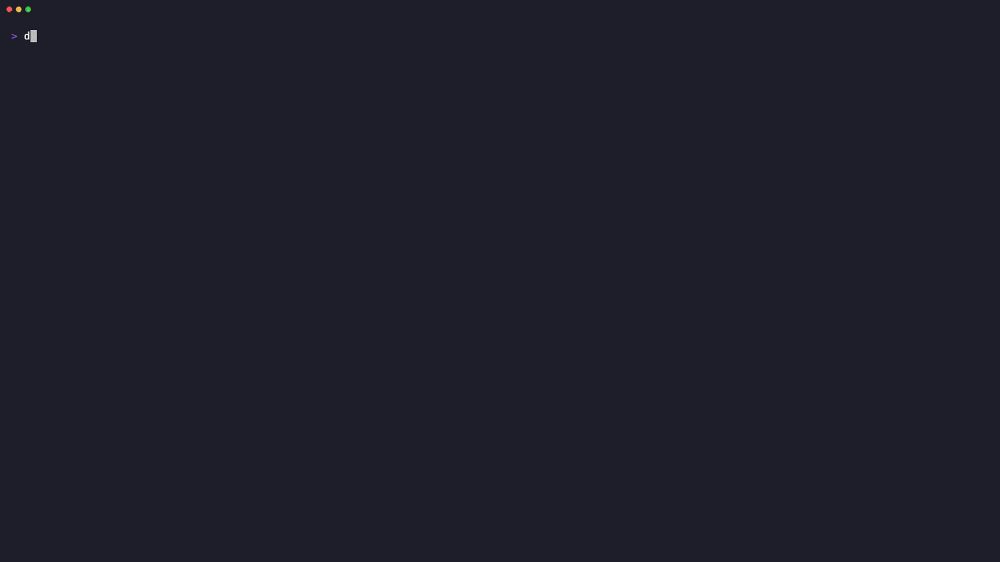
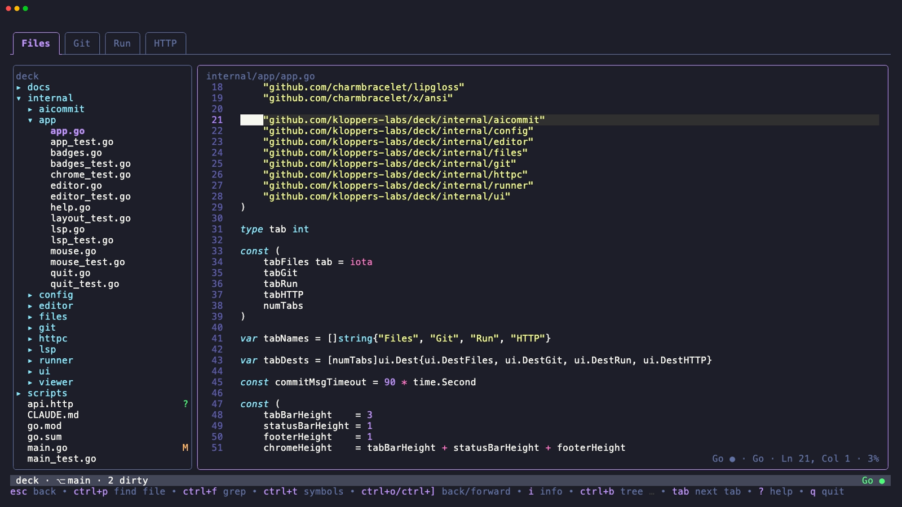
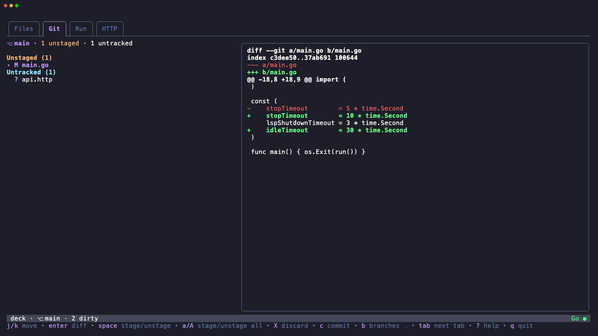
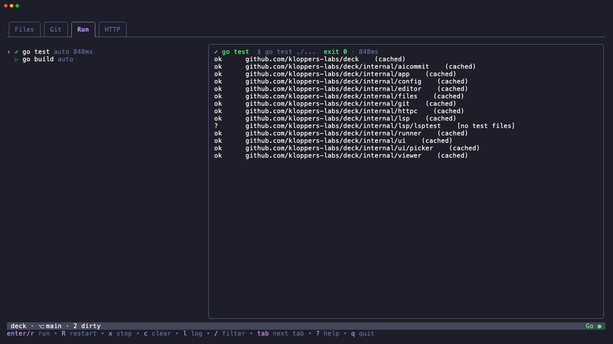
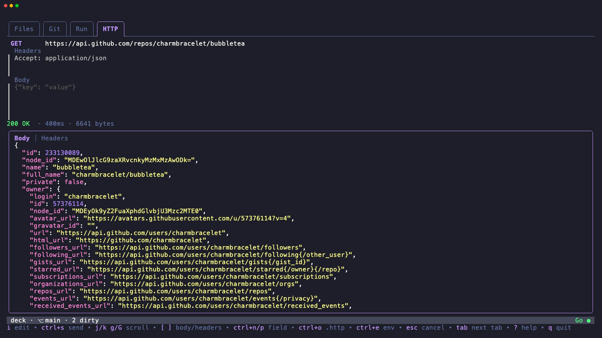

<div align="center">

# deck

**Your project's command center, in the terminal.**

Browse and navigate code, drive git, run tasks and send HTTP requests from one fast, keyboard-first TUI.

[](https://github.com/kloppers-labs/deck/actions/workflows/ci.yml)
[](https://github.com/kloppers-labs/deck/releases/latest)
[](go.mod)
[](LICENSE)




[Install](#install) · [Features](#features) · [Usage](#usage) · [Configuration](#configuration) · [Contributing](CONTRIBUTING.md)

</div>

## Why deck?

Most of a working day happens around the editor rather than in it: finding the file, reading the code, checking what changed, running the tests, poking an endpoint. deck puts all of that behind four tabs in one terminal window. Editing is handed to the editor you already use, and deck picks up exactly where you left off when it closes.

- **One window, four tabs.** Files, Git, Run and HTTP, switched with `1`–`4`.
- **Code intelligence built in.** Go to definition, references, hover docs, outlines and diagnostics through a built-in LSP client for nine languages.
- **Fast on big repos.** Rendering only touches the rows on screen, and highlighting, grep and git run in the background.
- **Keyboard first, mouse friendly.** Vim-style keys everywhere, plus clicks, wheel scrolling, hover popups and draggable panes.
- **Zero setup.** It detects your tasks, language servers and project layout. A config file is optional.

## Features

<table>
<tr>
<td width="50%"></td>
<td width="50%"></td>
</tr>
<tr>
<td width="50%"></td>
<td width="50%"></td>
</tr>
</table>

### Files

- File tree with git status badges, gitignore-aware hiding, sorting and file operations (new, rename, trash, copy path).
- Fuzzy **find file** (`ctrl+p`) and **live grep** (`ctrl+f`), powered by `fd` and `ripgrep` when available, with a preview as you move.
- Syntax-highlighted viewer that stays fast on 50k-line files, with search, a jump list and rendered Markdown.
- **LSP navigation**: go to definition (`gd`, `F12` or ctrl+click), references (`gr`), implementations, hover docs (`K`), document outline (`o`), workspace symbols (`ctrl+t`) and inline diagnostics.
- Language servers for C#, Go, TypeScript/JavaScript, Python, Rust, Bash, Lua, YAML and JSON. If one is missing, deck offers to install it.
- Directory cards that summarise a folder, including .NET projects and solutions.

### Git

- Staged, unstaged, untracked and conflicted changes, each with its diff.
- Stage, unstage or discard a file or everything; commit (with amend) from a built-in commit box.
- **AI commit messages** (`ctrl+g`) through the `claude`, `codex` or `crush` CLI you already use. deck never calls an AI API itself.
- Branch picker (switch, create, delete), commit log, and fetch, pull and push.
- **Review** (`v`): everything the branch changed against its base, committed and uncommitted, with per-file "viewed" ticks that clear when a file changes again.
- A line cursor in every diff: `v` selects lines, `enter` opens the file there, `@` points your agent at them.

### Run

- Detects tasks automatically for Go, npm, pnpm, yarn, bun, Angular, .NET, Python, Cargo, Ruby, Make and just. You can add your own in config.
- Streaming, colour-preserving logs with search, follow mode and wrap.
- A **problem matcher** for Go, TypeScript and MSBuild errors. Press `enter` to open the error in your editor.
- Every task runs in its own process group, so stopping a task stops everything it started. `ctrl+r` re-runs the last task from any tab.

### HTTP

- A small REST client: method, URL, headers and body, with highlighted responses, headers and latency.
- Runs your `.http` files (VS Code REST Client and JetBrains syntax): named requests, `{{variables}}`, `$guid`, `$timestamp`, `$dotenv` and environments from `http-client.env.json`.

## Install

deck runs on **macOS and Linux** (amd64 and arm64). On Windows, use it inside WSL.

### Homebrew (macOS)

```sh
brew install kloppers-labs/tap/deck
```

### Install script (macOS and Linux)

```sh
curl -fsSL https://raw.githubusercontent.com/kloppers-labs/deck/main/install.sh | sh
```

The script installs to `~/.local/bin` and checks the download against the release checksums. Set `DECK_INSTALL_DIR` to install somewhere else, or `DECK_VERSION=0.1.0` to pin a version.

### Linux packages

Every [release](https://github.com/kloppers-labs/deck/releases/latest) ships `.deb`, `.rpm` and `.apk` packages:

```sh
sudo apt install ./deck_*_amd64.deb      # Debian, Ubuntu
sudo dnf install ./deck-*.x86_64.rpm     # Fedora, RHEL
```

### Go

```sh
go install github.com/kloppers-labs/deck@latest
```

### From source

```sh
git clone https://github.com/kloppers-labs/deck.git
cd deck && go build -o deck . && ./deck
```

### Recommended companions

deck works with nothing but `git` installed. These tools make it better:

| Tool | What it adds |
|---|---|
| [micro](https://micro-editor.github.io) | The default editor. deck ships a tuned micro setup with LSP, a file tree and the Dracula theme. Any other editor works too. |
| [fd](https://github.com/sharkdp/fd), [ripgrep](https://github.com/BurntSushi/ripgrep) | Faster find-file and grep. Without them, deck falls back to git and a built-in walker. |
| Language servers | `gopls`, `typescript-language-server`, `pyright`, `rust-analyzer`, `csharp-ls`, … deck offers to install missing ones. |
| `claude`, `codex` or `crush` | AI commit messages. |

On macOS: `brew install micro fd ripgrep`.

## Usage

```sh
deck              # open the current directory
deck ~/code/app   # open another directory
deck --version
```

| Key | Action |
|---|---|
| `1` `2` `3` `4` / `tab` | Switch to Files, Git, Run, HTTP |
| `ctrl+p` / `ctrl+f` / `ctrl+t` | Find file / grep / workspace symbols |
| `gd` `gr` `K` `o` | Definition, references, hover, outline |
| `ctrl+o` / `ctrl+]` | Jump back / forward |
| `e` | Open in your editor at the cursor |
| `ctrl+r` | Re-run the last task |
| `v` / `V` | Select characters / lines in the viewer |
| `@` | Point your agent at the selection (or the cursor line) |
| `alt+j` | Go where your agent asked, if it was held while you typed |
| `alt+m` | Toggle mouse reporting (to select text) |
| `?` | Searchable help for every key |
| `q` | Quit (asks first if tasks are still running) |

### Editors

`e` opens the file at the current line and column. deck understands micro, vim, Neovim, Helix, Emacs, Kakoune, nano, VS Code (and forks), Zed, Sublime Text and JetBrains IDEs. Terminal editors take over the screen until you quit them. GUI editors open alongside deck. When micro closes, deck reveals the file and line you ended on (`editor_return = "origin"` goes back to where you started instead).

## Agents

deck lets a coding agent explore the code with you. You keep driving, and the agent can take the wheel to show you something. It always knows what you're looking at. The agent runs in its own terminal; deck can be in a split, a tab or another window.

```sh
deck where                      # what the user is looking at: file:line:col and the selection
deck open src/app.go:118-130    # show a file with lines selected (or a directory)
deck review                     # the branch's changes; --uncommitted, --base origin/dev
deck diff src/app.go:42         # one file's change, cursor on line 42
deck launch                     # start deck beside this terminal
deck ls                         # running decks
```

If no deck is running for the project, these commands start one beside the agent's terminal. This works in Orca, cmux, Paradev, tmux, Zellij, WezTerm, kitty (with `allow_remote_control`), Ghostty, iTerm2, Terminal and Alacritty. Elsewhere they print the command to run. Agent jumps go into deck's back/forward history (`ctrl+o` returns). While you're typing they wait as a hint until you press `alt+j`. deck refreshes the open file, the tree and the Git tab as the agent edits.

**Claude Code** connects to deck as its IDE. Start deck first (Claude auto-connects with `--ide` or `autoConnectIde`), or run `/ide` in Claude and pick deck. Claude then sees your file and selection with every prompt (`⧉ 3 lines selected`), `@` in deck drops `@file#L118-130` into Claude's prompt, and deck's status bar shows `✦ Claude`. Edits still ask for permission in Claude's own pane. Claude only auto-connects when exactly one editor is open on the folder, so with VS Code open on it too, use `/ide`.

Teach your agent the commands with `deck guide --install claude` (writes a Claude Code skill), or paste `deck guide` into your `AGENTS.md`.

## Configuration

Configuration is optional. deck reads `~/.config/deck/config.toml` (or `$XDG_CONFIG_HOME/deck/config.toml`) and then a project-local `.deck.toml` at the repository root. Project values override global ones, and project tasks are added to global ones. A typo or invalid value shows a warning with a suggestion; it never stops deck from starting.

```toml
editor = "nvim"            # micro (default), vim, nvim, hx, code, zed, …
mouse = "hover"            # hover | click | off
editor_return = "follow"   # follow | origin
ai_backend = "claude"      # claude | codex | crush
ai_model = "sonnet"

[files]
sidebar_width = 32
icons = "unicode"          # unicode | nerd | none
hide = ["bin", "obj", ".git", "node_modules"]

[viewer]
tab_width = 4
wrap = false
hover_delay_ms = 350

[lsp]
enabled = true
offer_install = true

[lsp.servers.go]
command = ["gopls", "-remote=auto"]

[git]
confirm_commit = true
review_base = ""           # "" = origin's default branch, origin/main, main, …

[agent]
enabled = true             # control socket for `deck open/where/…`
launch = "split"           # split | tab | window | off
watch = true               # refresh as files change on disk
claude = true              # Claude Code IDE bridge

[[tasks]]
name = "dev server"
cmd = "npm run dev"
dir = "web"
env = { PORT = "3000" }
```

## Built with

[Bubble Tea](https://github.com/charmbracelet/bubbletea), [Lip Gloss](https://github.com/charmbracelet/lipgloss) and [Bubbles](https://github.com/charmbracelet/bubbles) for the UI, [Chroma](https://github.com/alecthomas/chroma) for highlighting and [Glamour](https://github.com/charmbracelet/glamour) for Markdown. The LSP client is written from scratch on the Go standard library.

## Contributing

Bug reports, ideas and pull requests are welcome. See [CONTRIBUTING.md](CONTRIBUTING.md) to get started.

## License

[MIT](LICENSE). The bundled micro plugins keep their own licenses; see [THIRD_PARTY_NOTICES.md](THIRD_PARTY_NOTICES.md).
